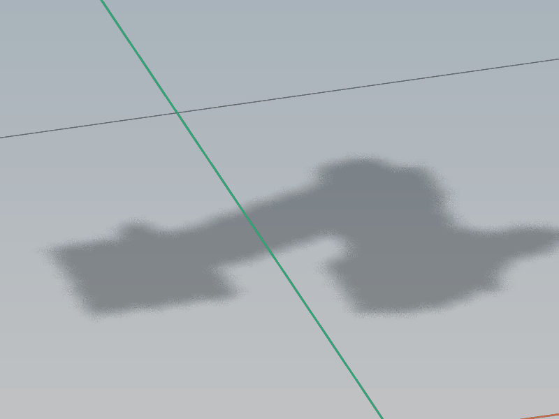
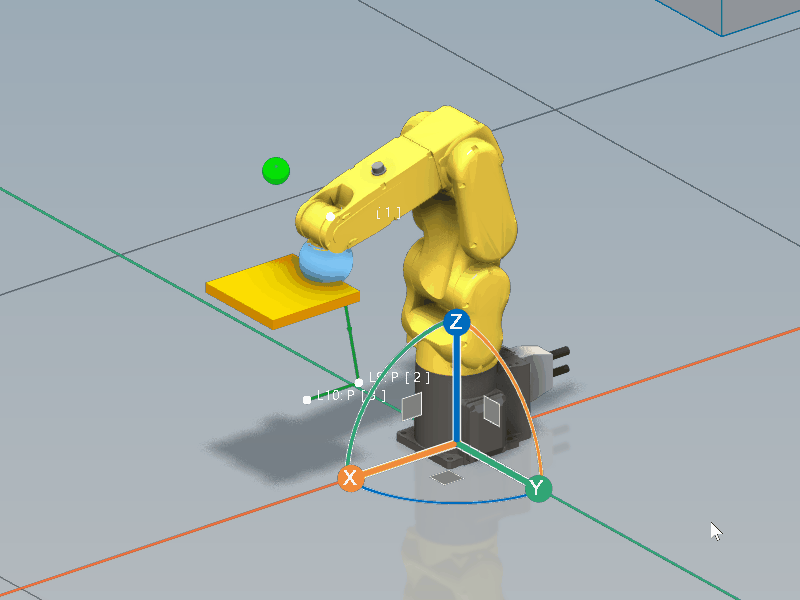
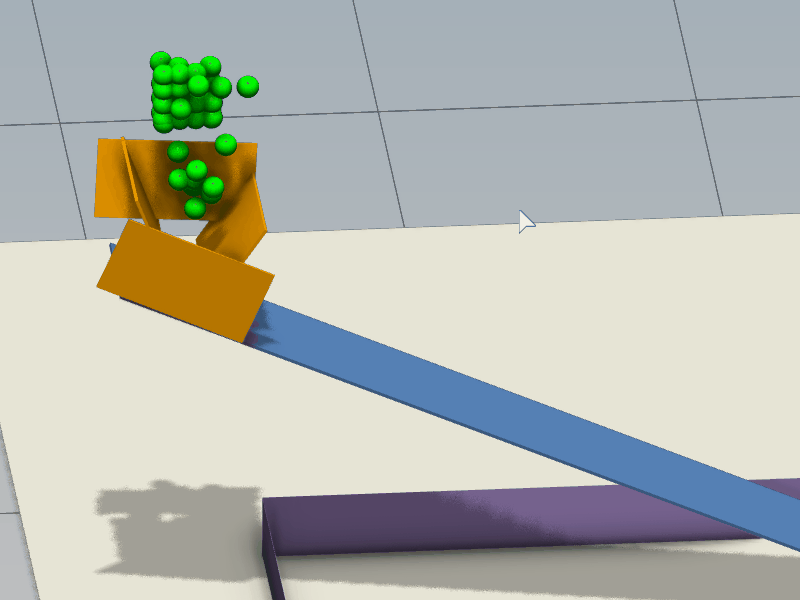
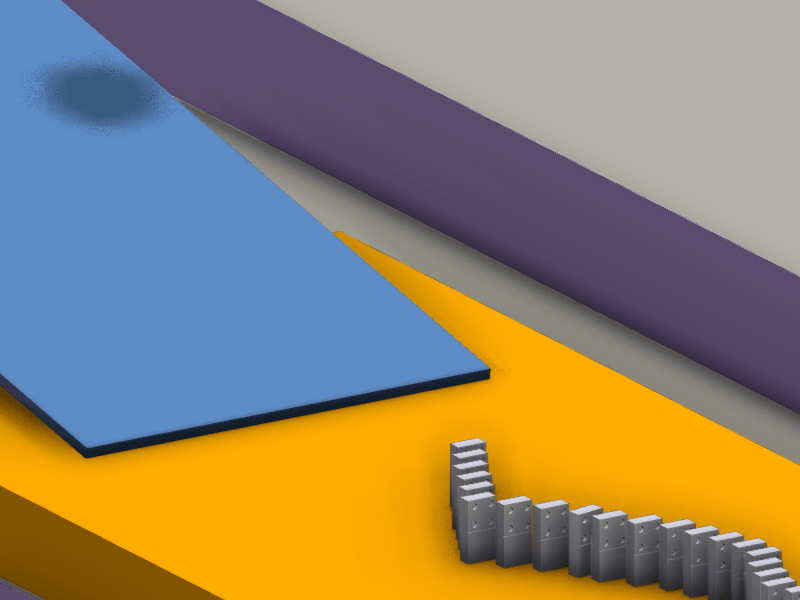

# rg_v10_cc
Roboguide v10 public repo of compressed cells.

(or cell-folders that can can be compressed as ".rgzip")

## Requirements 
**RG v10 rev.F**

## Cells

### Physics playground

- ### Shadow
    - 
    - simple cell using "roboguide physics" introduced in RG V10 rev.F
    - [Shadow](Shadow.rgzip)

- ### Slide
    - 
    - simple cell using "roboguide physics" introduced in RG V10 rev.F
    - [Slide](slide_physics.rgzip)

- ### Domino
    - 
    - simple cell using "roboguide physics" introduced in RG V10 rev.F
    - [Domino](domino_physics.rgzip)

## todo
- refactor and restructure repo.
    - do not upload rgzip, instead upload unzipped rgzip file folder and bat file to create rgzip file
- add license like public domain as far as possible

